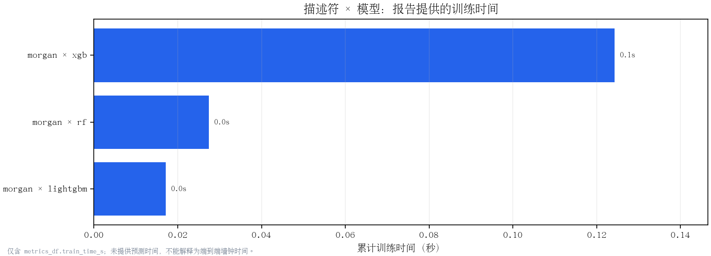
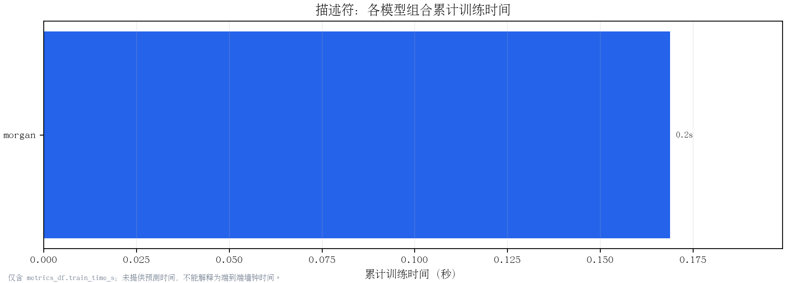
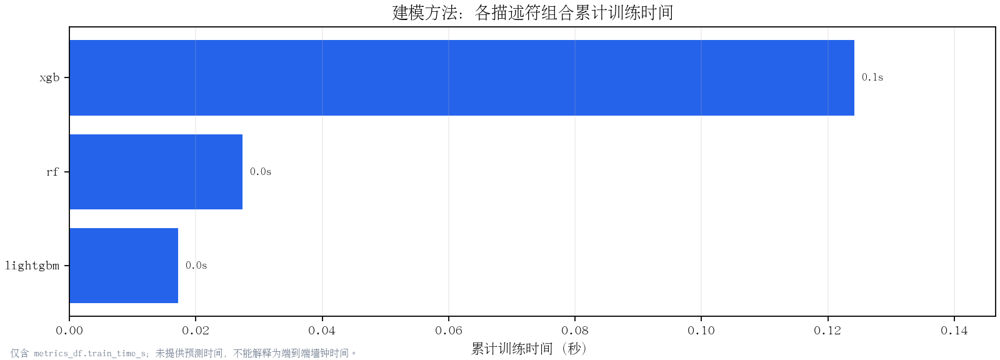
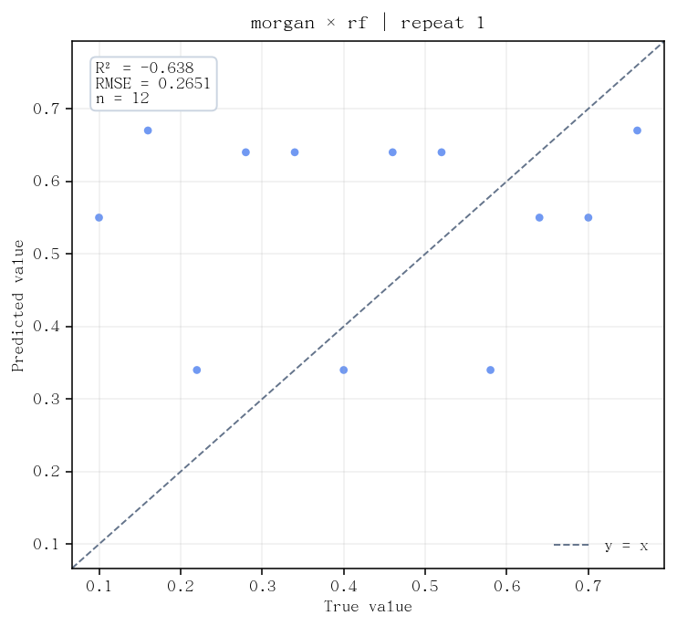
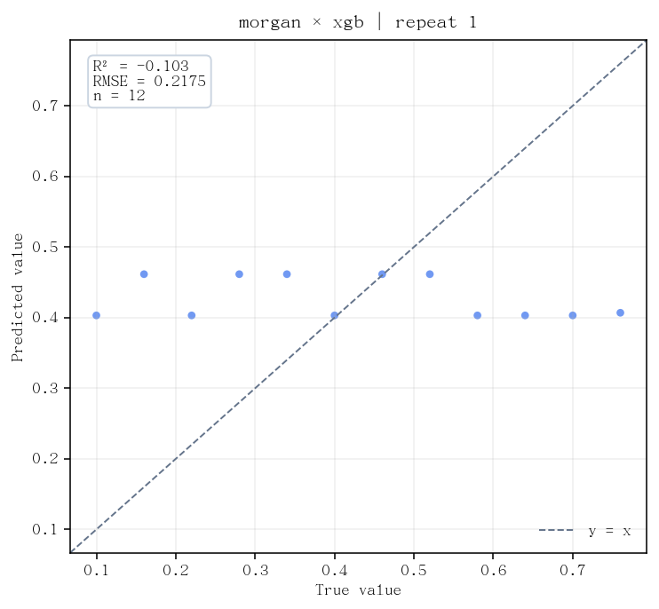
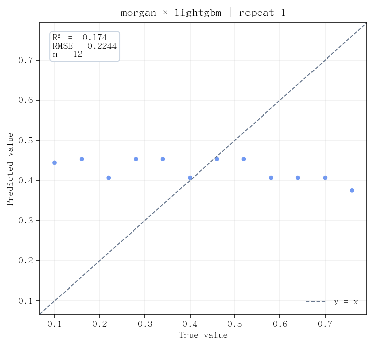

# YONOD 建模报告 — diag215_20260929_ordinary_fixed_off_v1

> 生成时间：2026-09-29 14:22:56  
> 评估组合数：3

---

## 训练与外层评估诊断

训练分数是已见样本上的拟合诊断，不代表泛化。基线常数取每折 outer-train 标签均值；R² 差距为训练减外层，RMSE/MAE 差距为外层减训练。缺失状态不进入外层排名。

| feature | model | repeat | fold | status | reason | worst_sample_id | worst_residual_y_true_minus_pred | heldout_target_min | heldout_target_max |
|---|---|---|---|---|---|---|---|---|---|
| morgan | rf | 1 | 1 | disabled | disabled | smoke-01 | -0.45000000000000007 | 0.1 | 0.7 |
| morgan | rf | 1 | 2 | disabled | disabled | smoke-02 | -0.5099999999999999 | 0.16 | 0.76 |
| morgan | xgb | 1 | 1 | disabled | disabled | smoke-01 | -0.30310397744178774 | 0.1 | 0.7 |
| morgan | xgb | 1 | 2 | disabled | disabled | smoke-12 | 0.3531499898433686 | 0.16 | 0.76 |
| morgan | lightgbm | 1 | 1 | disabled | disabled | smoke-01 | -0.34379999654988447 | 0.1 | 0.7 |
| morgan | lightgbm | 1 | 2 | disabled | disabled | smoke-12 | 0.3846000058948994 | 0.16 | 0.76 |

### 折间汇总

按 repeat 单列；标准差使用 ddof=0，各指标分别披露有效折数。原普通 OOF 仍按每个 repeat 汇总。

| feature | model | repeat | expected_folds | complete_folds | missing_or_failed_folds | std_ddof | train_r2_n | train_r2_mean | train_r2_std | train_rmse_n | train_rmse_mean | train_rmse_std | train_mae_n | train_mae_mean | train_mae_std | heldout_r2_n | heldout_r2_mean | heldout_r2_std | heldout_rmse_n | heldout_rmse_mean | heldout_rmse_std | heldout_mae_n | heldout_mae_mean | heldout_mae_std | baseline_r2_n | baseline_r2_mean | baseline_r2_std | baseline_rmse_n | baseline_rmse_mean | baseline_rmse_std | baseline_mae_n | baseline_mae_mean | baseline_mae_std | gap_r2_n | gap_r2_mean | gap_r2_std | gap_rmse_n | gap_rmse_mean | gap_rmse_std | gap_mae_n | gap_mae_mean | gap_mae_std |
|---|---|---|---|---|---|---|---|---|---|---|---|---|---|---|---|---|---|---|---|---|---|---|---|---|---|---|---|---|---|---|---|---|---|---|---|---|---|---|---|---|---|---|
| morgan | lightgbm | 1 | 2 | 0 | 2 | 0 | 0 | — | — | 0 | — | — | 0 | — | — | 0 | — | — | 0 | — | — | 0 | — | — | 0 | — | — | 0 | — | — | 0 | — | — | 0 | — | — | 0 | — | — | 0 | — | — |
| morgan | rf | 1 | 2 | 0 | 2 | 0 | 0 | — | — | 0 | — | — | 0 | — | — | 0 | — | — | 0 | — | — | 0 | — | — | 0 | — | — | 0 | — | — | 0 | — | — | 0 | — | — | 0 | — | — | 0 | — | — |
| morgan | xgb | 1 | 2 | 0 | 2 | 0 | 0 | — | — | 0 | — | — | 0 | — | — | 0 | — | — | 0 | — | — | 0 | — | — | 0 | — | — | 0 | — | — | 0 | — | — | 0 | — | — | 0 | — | — | 0 | — | — |

## 任务信息

| 项目 | 内容 |
|---|---|
| 任务名称 | diag215_20260929_ordinary_fixed_off_v1 |
| 项目文件夹 | `/home/wangzh685/桌面/ord-data/YONOD/result/diag215_20260929_ordinary_fixed_off_v1` |
| CSV 路径 | `<stored training results>` |
| 有效样本量 | 12 |
| SMILES 列 | `—` |
| 数值辅助列 | `（无）` |
| 标签列 | `yield` |

---

## 数据集来源

| 项目 | 信息 |
|---|---|
| 备注 | Step 2-15 isolated engineering acceptance; no scientific claim. |

---

## 结果矩阵（R²）

| 描述符 \ 模型 | rf | xgb | lightgbm |
|---|---|---|---|
| morgan | -0.6381 | -0.1028 | -0.1735 |

---

## 详细指标

| 描述符 | 模型 | evaluation_protocol | folds | oof_complete | R² 均值 | R² 标准差 | RMSE 均值 | RMSE 标准差 | MAE 均值 | MAE 标准差 | AutoGluon关键参数 | seed policy | 用时 |
|---|---|---|---|---|---|---|---|---|---|---|---|---|---|
| morgan | rf | outer_kfold | 2/2 (cv=2) | 是 | -0.6381 | 0.0000 | 0.2651 | 0.0000 | 0.2225 | 0.0000 | — | — | 0.0s |
| morgan | xgb | outer_kfold | 2/2 (cv=2) | 是 | -0.1028 | 0.0000 | 0.2175 | 0.0000 | 0.1848 | 0.0000 | — | — | 0.1s |
| morgan | lightgbm | outer_kfold | 2/2 (cv=2) | 是 | -0.1735 | 0.0000 | 0.2244 | 0.0000 | 0.1895 | 0.0000 | — | — | 0.0s |

---

## 协议与排名守卫

推荐排名只纳入 `evaluation_protocol=outer_kfold`、`expected_folds=completed_folds=cv`、`oof_complete=True`，且 RMSE/MAE 均值与标准差均完整的条目；`autogluon_internal_holdout` 只展示，不参与排名。

| 描述符 | 模型 | evaluation_protocol | cv | expected_folds | completed_folds | folds | oof_complete | OOF观测/总数 | RMSE | RMSE标准差 | MAE | MAE标准差 | autogluon_time_limit | autogluon_presets | autogluon_num_cpus | autogluon_seed_policy | 排名资格 | 排除原因 |
|---|---|---|---|---|---|---|---|---|---|---|---|---|---|---|---|---|---|---|
| morgan | rf | outer_kfold | 2 | 2 | 2 | 2/2 (cv=2) | 是 | 12/12 | 0.2651 | 0.0000 | 0.2225 | 0.0000 | — | — | — | — | 是 | 可进入排名 |
| morgan | xgb | outer_kfold | 2 | 2 | 2 | 2/2 (cv=2) | 是 | 12/12 | 0.2175 | 0.0000 | 0.1848 | 0.0000 | — | — | — | — | 是 | 可进入排名 |
| morgan | lightgbm | outer_kfold | 2 | 2 | 2 | 2/2 (cv=2) | 是 | 12/12 | 0.2244 | 0.0000 | 0.1895 | 0.0000 | — | — | — | — | 是 | 可进入排名 |

---

## 推荐组合（严格外层 CV 加权排名）

| 名次 | 描述符 | 模型 | evaluation_protocol | folds | OOF | R² | RMSE 均值±标准差 | MAE 均值±标准差 | 综合分 | 用时 | 推荐理由 |
|---|---|---|---|---|---|---|---|---|---|---|---|
| 🥇 1 | **morgan** | **xgb** | outer_kfold | 2/2 (cv=2) | 是 | -0.103 | 0.2175 ± 0.0000 | 0.1848 ± 0.0000 | 0.036 | 0.1s | 综合评分 0.036 排名靠前；协议=outer_kfold，fold=2/2 (cv=2)，OOF完整 |
| 🥈 2 | **morgan** | **lightgbm** | outer_kfold | 2/2 (cv=2) | 是 | -0.174 | 0.2244 ± 0.0000 | 0.1895 ± 0.0000 | -0.011 | 0.0s | 综合评分 -0.011 排名靠前；协议=outer_kfold，fold=2/2 (cv=2)，OOF完整 |
| 🥉 3 | **morgan** | **rf** | outer_kfold | 2/2 (cv=2) | 是 | -0.638 | 0.2651 ± 0.0000 | 0.2225 ± 0.0000 | -0.319 | 0.0s | 综合评分 -0.319 排名靠前；协议=outer_kfold，fold=2/2 (cv=2)，OOF完整 |

展开完整严格排名

| 名次 | 描述符 | 模型 | evaluation_protocol | folds | OOF | R² | RMSE 均值±标准差 | MAE 均值±标准差 | 综合分 | 用时 | 推荐理由 |
|---|---|---|---|---|---|---|---|---|---|---|---|
| 1 | morgan | xgb | outer_kfold | 2/2 (cv=2) | 是 | -0.103 | 0.2175 ± 0.0000 | 0.1848 ± 0.0000 | 0.036 | 0.1s ||
| 2 | morgan | lightgbm | outer_kfold | 2/2 (cv=2) | 是 | -0.174 | 0.2244 ± 0.0000 | 0.1895 ± 0.0000 | -0.011 | 0.0s ||
| 3 | morgan | rf | outer_kfold | 2/2 (cv=2) | 是 | -0.638 | 0.2651 ± 0.0000 | 0.2225 ± 0.0000 | -0.319 | 0.0s ||

---

## 建模耗时与成本对比

本路径仅汇总输入 `metrics_df.train_time_s`，未提供预测时间，故图表仅表示训练时间，不表示训练加预测时间或 CLI 端到端墙钟时间。描述符和建模方法图是组合时间的两种汇总视图，不与组合图相加；共享描述符特征化时间未提供，因此不重复归因。异常或缺失时间标为不可比较，不以零秒显示。

### 描述符 × 建模方法组合

| 描述符 | 模型 | 报告记录数 | 组合训练时间 | 可比较 | 时间状态 |
|---|---|---|---|---|---|
| morgan | xgb | 1 | 0.1s | 是 | reported_train_time |
| morgan | rf | 1 | 0.0s | 是 | reported_train_time |
| morgan | lightgbm | 1 | 0.0s | 是 | reported_train_time |

### 按描述符汇总

每根柱为该维度下所有完整且时间可比较组合的累计训练时间。

| 项目 | 预期组合数 | 可比较组合数 | 不可比较组合数 | 累计训练时间 | 可比较 | 时间状态 |
|---|---|---|---|---|---|---|
| morgan | 3 | 3 | 0 | 0.2s | 是 | complete_and_comparable |

### 按建模方法汇总

每根柱为该维度下所有完整且时间可比较组合的累计训练时间。

| 项目 | 预期组合数 | 可比较组合数 | 不可比较组合数 | 累计训练时间 | 可比较 | 时间状态 |
|---|---|---|---|---|---|---|
| xgb | 1 | 1 | 0 | 0.1s | 是 | complete_and_comparable |
| rf | 1 | 1 | 0 | 0.0s | 是 | complete_and_comparable |
| lightgbm | 1 | 1 | 0 | 0.0s | 是 | complete_and_comparable |

---

## OOF 预测散点图

### morgan × rf × repeat-1

### morgan × xgb × repeat-1

### morgan × lightgbm × repeat-1

---

## 指标说明

**R²（决定系数）**：衡量模型预测方差占真实方差的比例，取值上限为 1。

- R² > 0.85：预测可靠性较强，可用于辅助筛选实验条件
- R² 0.7～0.85：中等预测能力，趋势判断可参考，具体数值需谨慎
- R² < 0.7 或负值：拟合效果弱；样本量极少时负值属正常现象

**RMSE（均方根误差）**：对大误差样本更敏感。标签归一化到 [0,1] 时，单位等同于产率百分点。

- RMSE < 0.05：平均误差约 5 个百分点，接近实验重复性误差范围
- RMSE 0.05～0.10：中等误差，可区分高产率和低产率区间
- RMSE > 0.10：误差偏大，不建议用于定量预测

**MAE（平均绝对误差）**：对每个样本的预测偏差取绝对值后平均。

- MAE < 0.04：典型偏差极小，预测稳定性好
- MAE 0.04～0.08：中等偏差，结合 R² 综合评估
- MAE > 0.08：典型偏差较大

**综合评分**：S = R² × 0.5 + (1 − RMSE / RMSE_max) × 0.3 + (1 − MAE / MAE_max) × 0.2

---

*由 YONOD report.py 自动生成 · 2026-09-29 14:22:56*